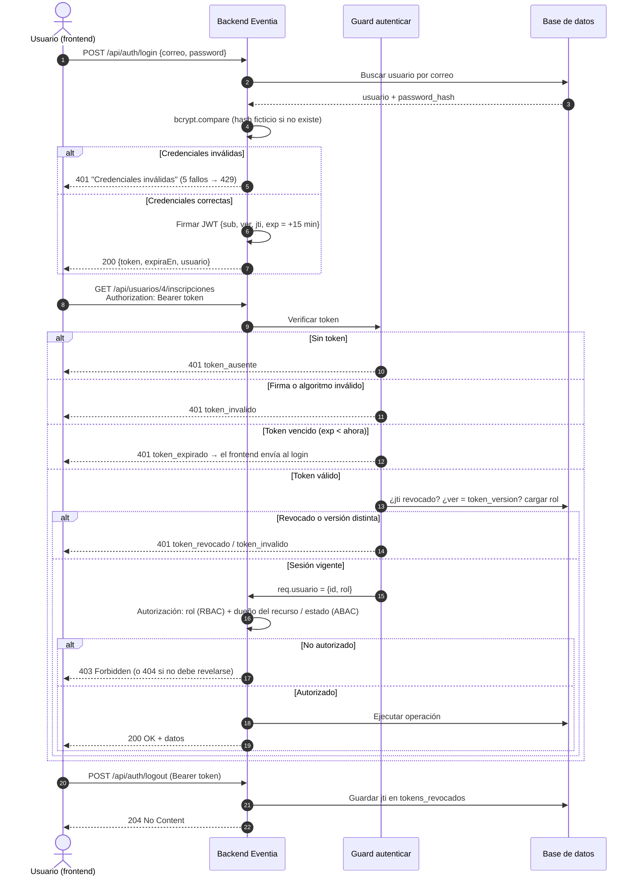

# Eventia: autenticación y control de acceso

**Universidad Rafael Landívar** — Campus San Alberto Hurtado, S.J. de Quetzaltenango
**Curso:** Programación Web — **Docente:** Ing. Manuel Rojas
**Actividad 24**

Nombre: ______________________________ Carné: ______________

Repositorio: https://github.com/Berman-05/eventia

---

## 1) Selección del mecanismo de autenticación

### Comparación

| Criterio | Sesiones de servidor con cookies seguras | Tokens JWT | OpenID Connect (federado) |
|---|---|---|---|
| Dónde vive el estado | En el servidor (almacén de sesiones); el navegador solo guarda un id opaco | En el token firmado que guarda el cliente; el servidor solo verifica la firma | En un proveedor de identidad externo (Google, Microsoft, Auth0…), que emite un ID token y un access token |
| Cómo viaja | Cookie `HttpOnly; Secure; SameSite` automática | Header `Authorization: Bearer <token>` | Redirección al proveedor y luego un token (normalmente JWT) o una sesión propia |
| Cierre de sesión | Inmediato: se borra la sesión del servidor | No es inmediato: el token sigue siendo válido hasta `exp`, salvo que se mantenga una lista de revocación | Hay que cerrar la sesión local y, opcionalmente, la del proveedor |
| Escalado / varios servicios | Requiere almacén compartido (Redis) entre instancias | Cualquier servicio con la clave verifica el token sin consultar a nadie | Muy bueno: los servicios validan tokens del proveedor |
| Clientes móviles / otros servicios | Incómodo (cookies, CSRF) | Natural | Natural |
| Riesgos principales | CSRF (se mitiga con `SameSite` y token anti-CSRF), fijación de sesión | Robo del token (XSS si se guarda en `localStorage`), algoritmo mal fijado, tokens sin expiración, imposibilidad de revocar | Configuración compleja (redirect URIs, `state`, `nonce`, PKCE) y dependencia de un tercero |
| Complejidad para Eventia hoy | Baja | Baja–media | Alta |

### Decisión

1. **¿Qué alternativa usaríamos?** **JWT** de corta duración (access token de 15 minutos, firmado con HS256), complementado con controles del lado del servidor: lista de revocación por `jti` para el logout y `token_version` por usuario para cerrar todas las sesiones.

2. **¿Por qué es adecuada para la arquitectura?** Eventia expone una API REST consumida por un frontend separado y, según el plan de crecimiento de la Actividad 21, evolucionará hacia servicios independientes (eventos, inscripciones, notificaciones). Con JWT cada servicio puede verificar la identidad sin depender de un almacén de sesiones compartido, y el mismo mecanismo sirve para una futura app móvil. OpenID Connect se descarta por ahora: Eventia gestiona sus propias cuentas y no necesita inicio de sesión con terceros en esta versión, aunque podría añadirse luego sin cambiar la autorización (el proveedor reemplazaría solo el paso de "verificar identidad"). Las sesiones con cookies serían igual de válidas para un monolito, pero obligarían a rediseñar al separar servicios.

3. **Ventajas y limitaciones.**
   - Ventajas: sin estado para verificar (escala horizontalmente), estándar ampliamente soportado, funciona igual para web, móvil y servicios, el token lleva la expiración incluida.
   - Limitaciones: no se puede "borrar" un token emitido; por eso añadimos revocación en servidor, lo que reintroduce algo de estado (una tabla pequeña). Si el token se roba, sirve hasta que expire o se revoque; se mitiga con expiración corta y HTTPS. El rol **no** se toma del token sino de la BD en cada solicitud, para que un cambio de rol o una cuenta desactivada surtan efecto de inmediato.

4. **¿Cómo se mantiene la autenticación entre solicitudes?** El cliente guarda el token recibido en el login y lo envía en cada petición en el header `Authorization: Bearer <token>`. El guard `autenticar` ([src/middleware/auth.js](src/middleware/auth.js)) verifica en cada solicitud la firma, el algoritmo (solo HS256, rechaza `alg: none`), la expiración, que el `jti` no esté revocado y que `ver` coincida con `token_version` del usuario; después carga al usuario desde la BD en `req.usuario`. En el frontend se recomienda guardar el token en memoria (no en `localStorage`) para reducir el impacto de un XSS.

5. **Cierre de sesión y expiración.**
   - **Expiración:** el token vence a los 15 minutos (`exp`). Una petición con token vencido recibe `401` con `codigo: "token_expirado"` y el header `WWW-Authenticate: Bearer error="invalid_token"`; el frontend debe redirigir al login.
   - **Logout:** `POST /api/auth/logout` guarda el `jti` del token en `tokens_revocados` hasta su `exp`; cualquier uso posterior recibe `401 token_revocado`. Las entradas vencidas se limpian al iniciar el servidor.
   - **Cerrar todas las sesiones:** `POST /api/auth/logout-todas` incrementa `token_version`; todos los tokens anteriores del usuario quedan inválidos. Lo mismo ocurre automáticamente cuando un administrador cambia el rol de un usuario.
   - Mejora futura: refresh token en cookie `HttpOnly` con rotación, para no pedir la contraseña cada 15 minutos.

---

## 2) Diagrama del flujo de autenticación



> GitHub muestra este diagrama renderizado. Para el documento impreso se puede exportar desde <https://mermaid.live>.

---

## 3) Matriz de roles y permisos

✅ permitido · ❌ denegado · ⚠️ permitido solo si se cumple la condición

| # | Operación | Visitante | Usuario registrado | Organizador | Administrador | Endpoint y comprobaciones |
|---|---|---|---|---|---|---|
| 1 | Consultar eventos públicos | ✅ | ✅ | ✅ | ✅ | `GET /api/eventos` — público, sin token |
| 2 | Inscribirse en eventos | ❌ 401 | ⚠️ evento abierto, con cupo, máx. 4 lugares, una inscripción por evento | ⚠️ mismas condiciones y nunca en sus propios eventos | ❌ 403 | `POST /api/eventos/{id}/inscripciones` |
| 3 | Consultar inscripciones propias | ❌ 401 | ⚠️ solo si `{id}` = su id | ⚠️ solo si `{id}` = su id | ✅ cualquiera (auditoría) | `GET /api/usuarios/{id}/inscripciones`, `GET /api/inscripciones/mias` |
| 4 | Crear eventos | ❌ 401 | ❌ 403 | ✅ queda como dueño (`organizador_id` = id del token) | ✅ | `POST /api/eventos` |
| 5 | Modificar eventos propios | ❌ 401 | ❌ 403 | ⚠️ `organizador_id` = su id **y** evento abierto | ✅ evento abierto | `PUT /api/eventos/{id}` |
| 6 | Modificar eventos de otros organizadores | ❌ 401 | ❌ 403 | ❌ 403 aunque tenga el rol | ⚠️ solo como moderación (evento abierto) | `PUT /api/eventos/{id}` |
| 7 | Consultar participantes de eventos propios | ❌ 401 | ❌ 403 | ⚠️ solo si el evento le pertenece | ✅ | `GET /api/eventos/{id}/inscripciones` |
| 8 | Administrar usuarios (listar, cambiar rol) | ❌ 401 | ❌ 403 | ❌ 403 | ✅ con sesión vigente | `GET /api/usuarios`, `PATCH /api/usuarios/{id}/rol` |

**Rol frente a autorización sobre el recurso.** El rol solo dice qué *tipo* de operaciones puede intentar una persona. Que pueda ejecutarlas sobre un recurso concreto depende de atributos de ese recurso: quién es el dueño y en qué estado está. Por eso las filas 3, 5, 6 y 7 dan respuestas distintas a dos usuarios del mismo rol. Además, el frontend puede ocultar botones, pero cada endpoint repite estas comprobaciones en el backend.

---

## 4) Análisis de situaciones de control de acceso

### Situación A — Un organizador modifica un evento de otro organizador
1. **Decisión:** rechazar.
2. **Comprobaciones:** (1) token válido y vigente; (2) rol `organizador` o `administrador`; (3) el evento existe; (4) `evento.organizador_id == usuario.id` (o rol administrador). Falla la 4.
3. **Código HTTP:** `403 Forbidden`. El usuario está autenticado y el evento es público (su existencia no es secreta), pero no tiene permiso sobre él.
4. **Modelo:** **RBAC + ReBAC**. El rol habilita la función "modificar eventos", pero la decisión final depende de la **relación** "el usuario es organizador de este evento". Sin esa relación, RBAC solo permitiría a cualquier organizador modificar cualquier evento, que es justo la vulnerabilidad.
5. **Implementación:** `verificarPropietario()` en [src/routes/eventos.js](src/routes/eventos.js).

### Situación B — Un usuario consulta las inscripciones privadas de otra persona
1. **Decisión:** rechazar.
2. **Comprobaciones:** (1) token válido; (2) el `{id}` solicitado es igual a `req.usuario.id` o el rol es administrador. El id del usuario se toma del token, nunca de un parámetro que el cliente pueda cambiar.
3. **Código HTTP:** `403 Forbidden` en `GET /api/usuarios/{id}/inscripciones` (el usuario sabe que la persona existe, pero no puede ver sus datos). En `GET /api/inscripciones/{id}` se responde `404 Not Found` para no confirmar que ese id de inscripción existe y evitar la enumeración.
4. **Modelo:** **ReBAC** (relación de propiedad "la inscripción pertenece al usuario"), con una excepción **RBAC** para el administrador. El rol "usuario registrado" es el mismo para ambas personas, así que el rol solo no puede distinguirlas.
5. **Implementación:** [src/routes/usuarios.js](src/routes/usuarios.js) y [src/routes/inscripciones.js](src/routes/inscripciones.js).

### Situación C — Un administrador opera con una sesión vencida
1. **Decisión:** rechazar. El rol más privilegiado no exime de autenticarse; al contrario, son las operaciones que más deben protegerse.
2. **Comprobaciones:** el guard verifica la firma y `exp` **antes** que cualquier comprobación de rol. Como `exp` ya pasó, la petición se corta ahí y la operación no se ejecuta. También se verifica que el token no esté revocado ni tenga una `token_version` antigua.
3. **Código HTTP:** `401 Unauthorized` con `codigo: "token_expirado"` y `WWW-Authenticate: Bearer error="invalid_token"`. No es 403: el problema no es de permisos sino que la identidad ya no está demostrada. El cliente debe volver a iniciar sesión.
4. **Modelo:** no se llega a aplicar RBAC/ABAC/ReBAC: la **autenticación** es un requisito previo de cualquier modelo de autorización. Si se quiere expresar como regla, es una condición **ABAC** sobre un atributo del contexto (vigencia de la credencial), evaluada antes del rol. Para operaciones administrativas sensibles se recomienda además pedir reautenticación reciente o MFA (también atributos ABAC).

### Situación D — Un organizador modifica su propio evento ya cerrado
1. **Decisión:** rechazar.
2. **Comprobaciones:** (1) token válido; (2) rol organizador; (3) el evento le pertenece ✔; (4) `evento.estado == 'abierto'` ✘.
3. **Código HTTP:** `409 Conflict` con `codigo: "evento_cerrado"`. El usuario sí tiene permiso sobre el evento (no es 403); lo que impide la operación es el **estado actual del recurso**, que entra en conflicto con la solicitud.
4. **Modelo:** **ABAC**. La regla depende de un atributo del recurso (`estado`), no del rol ni de la relación. Combinado: RBAC (rol) → ReBAC (dueño) → ABAC (estado).
5. **Implementación:** `verificarAbierto()` en [src/routes/eventos.js](src/routes/eventos.js). Los eventos se cierran con `POST /api/eventos/{id}/cerrar`; el evento 4 de los datos semilla ya está cerrado.

| Situación | Decisión | Código | Modelo |
|---|---|---|---|
| A. Modificar evento ajeno | Rechazar | 403 | RBAC + ReBAC |
| B. Ver inscripciones ajenas | Rechazar | 403 (404 por id de inscripción) | ReBAC (+ RBAC para admin) |
| C. Admin con sesión vencida | Rechazar | 401 | Autenticación previa (atributo de contexto, ABAC) |
| D. Modificar evento propio cerrado | Rechazar | 409 | ABAC |

---

## 5) Mecanismo de autenticación implementado

Stack: Node.js 24, Express 5, SQLite (`node:sqlite`), `jsonwebtoken`, `bcryptjs`. Los guards se implementan como middleware de Express, que cumple el mismo papel que los `Guards` de NestJS: se ejecutan antes del handler y cortan la petición si no se cumple la condición.

| Pieza | Archivo | Qué hace |
|---|---|---|
| Login | [src/routes/auth.js](src/routes/auth.js) | Verifica con bcrypt, mensaje genérico, rate limit de 5 intentos fallidos / 15 min, emite JWT con `sub`, `ver`, `jti`, `exp` (15 min) |
| Guard de autenticación | [src/middleware/auth.js](src/middleware/auth.js) `autenticar` | Bearer obligatorio, solo HS256, distingue `token_ausente` / `token_invalido` / `token_expirado` / `token_revocado`, carga el rol desde la BD |
| Guard de roles | [src/middleware/auth.js](src/middleware/auth.js) `requiereRol` | RBAC por endpoint |
| Ruta protegida | `GET /api/auth/me` | Devuelve el usuario del token |
| Logout | `POST /api/auth/logout`, `POST /api/auth/logout-todas` | Revocación por `jti` y por `token_version` |
| Tablas | [src/db.js](src/db.js) | `usuarios.token_version`, `tokens_revocados`, `eventos.estado` (con migración automática) |

Demostración (detalle completo en [evidencias/act24-pruebas.md](evidencias/act24-pruebas.md)):
- **Inicio de sesión:** `POST /api/auth/login` como Carlos → `200` con `token`, `tipo: "Bearer"`, `expiraEn`.
- **Ruta protegida:** `GET /api/auth/me` con el token → `200`.
- **Sin autenticación:** `GET /api/auth/me` sin header → `401 token_ausente`.
- **Credencial inválida o vencida:** token vencido → `401 token_expirado`; token alterado → `401 token_invalido`; token tras logout → `401 token_revocado`.

## 6) Controles de autorización implementados

**Control 1 — Un organizador solo modifica eventos que le pertenecen.**
```js
// src/routes/eventos.js
router.put('/:id', auth, requiereRol('organizador', 'administrador'), validar(schemas.modificarEvento), (req, res) => {
  const evento = obtenerEvento(idParam(req.params.id));
  verificarPropietario(evento, req.usuario);   // 403 si organizador_id !== usuario.id
  verificarAbierto(evento, 'El evento está cerrado y no admite cambios'); // 409
  ...
});
```
El mismo `verificarPropietario` protege `POST /eventos/{id}/cerrar` y `GET /eventos/{id}/inscripciones` (participantes). `GET /eventos/mios` filtra por el id del token, de modo que un organizador no obtiene los ids de eventos ajenos desde su panel.

**Control 2 — Un usuario solo consulta sus propias inscripciones.**
```js
// src/routes/usuarios.js
router.get('/:id/inscripciones', auth, (req, res) => {
  const id = idParam(req.params.id);
  if (req.usuario.rol !== 'administrador' && req.usuario.id !== id) {
    throw new HttpError(403, 'Solo puede consultar sus propias inscripciones');
  }
  ...
});
```
Y en `GET /api/inscripciones/{id}` solo responde al dueño, al organizador de ese evento o al administrador (los demás reciben 404).

Ambos controles se ejecutan en el backend y se prueban llamando directamente a la API, sin pasar por el frontend.

---

## 7) Pruebas

Herramientas:
- Colección [docs/eventia-act24.postman_collection.json](docs/eventia-act24.postman_collection.json) (Postman o Thunder Client → *Import*). Se ejecuta en orden con el servidor recién iniciado (`npm start`). La carpeta "0. Preparación" hace los logins y crea los datos necesarios. El token vencido se genera en un *pre-request script* que firma un JWT con `exp` en el pasado; también se puede obtener con `npm run token:vencido`.
- Pruebas automatizadas: `npm test` → **46 pruebas, 46 aprobadas** ([evidencias/resultado-pruebas.txt](evidencias/resultado-pruebas.txt)).

| # | Operación realizada | Usuario / rol | Resultado esperado | Código HTTP obtenido | Resultado real | Captura |
|---|---|---|---|---|---|---|
| 1 | `GET /api/auth/me` sin token | Visitante | Rechazar (401) | **401** | ✅ "Autenticación requerida" (`token_ausente`) | _captura 1_ |
| 2 | `GET /api/auth/me` con token | Carlos (usuario registrado) | Permitir (200) | **200** | ✅ Devuelve `{id: 4, nombre: "Carlos", …}` | _captura 2_ |
| 3 | `PUT /api/eventos/1` `{precio: 80}` | Olga (organizadora dueña) | Permitir (200) | **200** | ✅ Evento actualizado, `precio: 80` | _captura 3_ |
| 4 | `PUT /api/eventos/2` `{precio: 999}` | Olga (el evento es de Oscar) | Rechazar (403) | **403** | ✅ "El evento no le pertenece"; el evento no cambia | _captura 4_ |
| 5 | `GET /api/usuarios/4/inscripciones` | Ana (usuario registrado) | Rechazar (403) | **403** | ✅ "Solo puede consultar sus propias inscripciones" | _captura 5_ |
| 6 | `GET /api/auth/me` con token vencido / alterado / tras logout | Carlos | Rechazar (401) | **401** | ✅ `token_expirado` / `token_invalido` / `token_revocado` | _captura 6_ |

Pruebas adicionales ejecutadas (mismo archivo de evidencias): Carlos consulta sus propias inscripciones → 200; Ana consulta la inscripción de Carlos por id → 404; administrador con token vencido intenta cambiar un rol → 401 y el rol no cambia (Situación C); Olga modifica su evento cerrado → 409 (Situación D).

> **Capturas:** importar la colección en Postman, ejecutar *Run collection* y tomar una captura de cada petición de la carpeta "Pruebas" (o del resumen del *Collection Runner*), y pegarlas en la columna "Captura".
